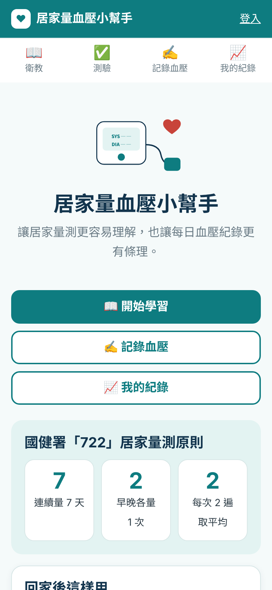
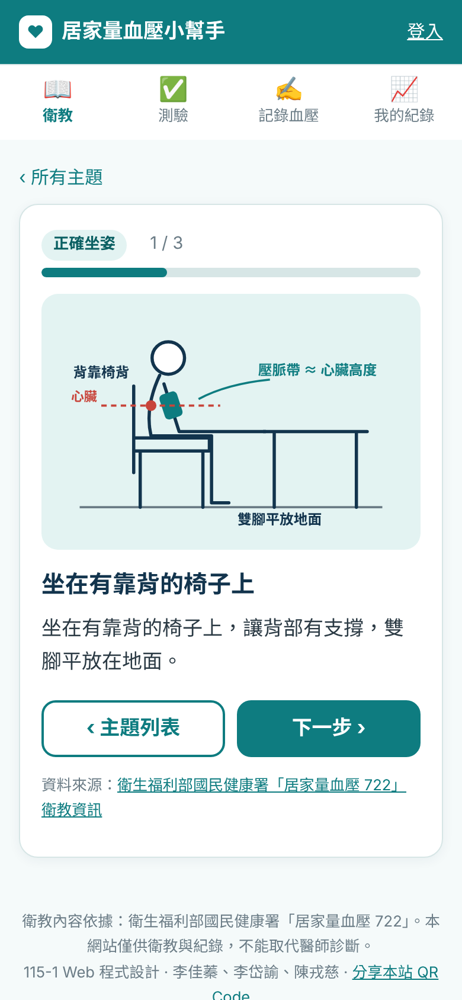
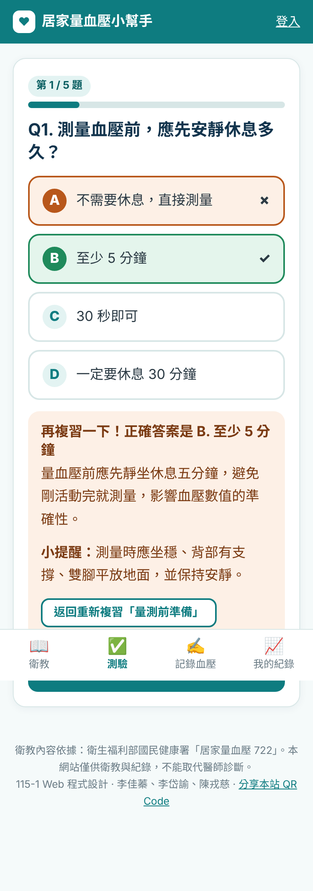
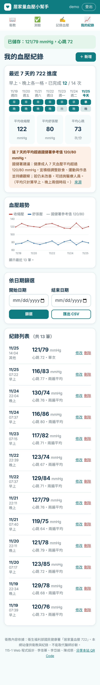

# 居家血壓量測衛教與紀錄系統（居家量血壓小幫手）

115-1 Web 程式設計 期末專題｜組員：113029305 李佳蓁、113029418 李岱諭、113029415 陳戎慈

> 讓居家量測更容易理解，也讓每日血壓紀錄更有條理。

Django 5.2 + SQLite，手機優先的 RWD 網站。衛教內容依據衛生福利部國民健康署「居家量血壓 722」衛教資訊。

| 首頁 | 圖文學習 | Quiz 答錯回饋 | 我的紀錄 |
|---|---|---|---|
|  |  |  |  |

---

## 一、快速開始（macOS / Windows）

```bash
git clone https://github.com/<帳號>/<repo 名稱>.git bp_helper
cd bp_helper
python3 -m venv .venv
source .venv/bin/activate          # Windows：.venv\Scripts\activate
pip install -r requirements.txt

python manage.py migrate           # 建立資料庫，並自動寫入 5 題預設 Quiz
python manage.py seed_demo         # （選用）建立展示帳號 demo / demo722bp 與 7 天示範紀錄
python manage.py createsuperuser   # （選用）建立後台管理員，可到 /admin 修改題目
python manage.py runserver
```

打開 http://127.0.0.1:8000/

**用手機測試（同一個 Wi-Fi）：**

```bash
DJANGO_ALLOWED_HOSTS=* python manage.py runserver 0.0.0.0:8000
```

手機開 `http://<電腦的區網 IP>:8000/`，或在電腦開 `/qr/` 直接掃碼。

**執行測試：** `python manage.py test`（23 個測試；push 到 GitHub 時也會由 GitHub Actions 自動執行，設定在 `.github/workflows/tests.yml`）

---

## 二、功能對照期中提案

### Must Have（全部完成）

| 提案項目 | 實作內容 | 網址 |
|---|---|---|
| 響應式首頁與衛教頁面（手機可用） | mobile-first CSS；手機有底部導覽列，電腦版改成頂部導覽 | `/` |
| 正確量測步驟圖文（依國健署資料） | 4 個主題、13 頁，一頁一步驟，每頁都有示意圖與資料來源；看完的主題會打勾 | `/learn/` |
| 衛教 Quiz 與結果回饋 | 5 題，選完立即顯示對錯；答錯會給解說、小提醒，以及「返回重新複習」對應主題（Teach-back）；最後有逐題回顧 | `/quiz/` |
| 量測前檢查清單 | 6 項全部打勾才算完成；完成後 1 小時內去輸入血壓，就不用再勾一次 | `/checklist/` |
| 血壓紀錄新增與查詢（個人帳號） | 註冊／登入；**量測時間自動帶入按下儲存當下的時間**（不用手打，要補登過去的紀錄再勾選「補登」）；時段（早上／晚上）依時間自動選好；輸入第 1、2 遍數值後**自動取平均**（722 原則）；可以修改、刪除；每人只看得到自己的紀錄 | `/records/` |
| 手機掃碼即可開啟 | 自動產生本站網址的 QR Code，可以列印給門診使用 | `/qr/` |

### Nice to Have

| 提案項目 | 狀態 |
|---|---|
| 血壓折線趨勢圖 | ✅ 完成：收縮壓、舒張壓兩條線，加上國健署參考值虛線；伺服器端產生 SVG，不需要外部套件 |
| 依日期篩選紀錄 | ✅ 完成 |
| 紀錄匯出 CSV | ✅ 完成（會套用目前的篩選條件；加了 BOM，用 Excel 開中文不會變亂碼） |
| 每日量測提醒 | ⏳ 尚未實作（需要推播或 Email 服務） |
| 更多互動題型 | ⏳ 尚未實作 |

### 額外加上的功能

- **722 進度表**：最近 7 天的早／晚各一格（共 14 格），已經量過的格子會亮起來
- **7 天平均**：平均只算早上、晚上兩個時段；超過國健署參考值 120/80 mmHg 時，會顯示國健署的建議原文與來源（不做診斷）
- **自動時間**：畫面上有即時時鐘；儲存時用伺服器時間（Asia/Taipei），所以就算頁面開著很久才送出，時間也是對的
- **輸入防呆**：收縮壓必須大於舒張壓、不能選未來時間、數值超出合理範圍會提示，第 2 遍要嘛三格都填、要嘛三格都空

---

## 三、系統架構（對應提案第 08 頁）

| Django 元件 | 本專案中的位置 |
|---|---|
| URL Routing | `config/urls.py` → `education/urls.py`、`records/urls.py`、`accounts/urls.py` |
| View | `education/views.py`（衛教、Quiz 判分、檢查清單、QR）、`records/views.py`（紀錄新增／查詢／篩選／CSV） |
| Template | `templates/base.html`（共用版型）＋各 app 的 `templates/` |
| Model | `records/models.py`（血壓紀錄）、`education/models.py`（Quiz 題目、選項） |
| SQLite Database | `db.sqlite3` |

### 資料表：`BloodPressureRecord`

| 欄位 | 型別 | 說明 |
|---|---|---|
| id | BigAutoField | 紀錄編號（主鍵） |
| user | FK → User | 這筆紀錄屬於誰（個人帳號） |
| systolic | PositiveSmallInteger | 收縮壓（mmHg），兩遍時存平均值 |
| diastolic | PositiveSmallInteger | 舒張壓（mmHg） |
| pulse | PositiveSmallInteger | 心跳（次／分鐘） |
| measured_at | DateTime | 量測日期與時間 |
| period | Char | 早上／晚上／其他（用來計算 722 進度） |
| readings_count | PositiveSmallInteger | 1 = 單次；2 = 兩遍平均 |
| checklist_done | Boolean | 是否完成量測前檢查 |
| note | Char | 備註 |
| created_at | DateTime | 建立時間 |

> 數值範圍限制（收縮壓 50–260、舒張壓 30–160、心跳 30–220）只是為了擋掉打錯字，**不是醫療判讀標準**。

### Quiz：`Question` / `Choice`

題目存在資料庫中，預設 5 題由 `education/migrations/0002_seed_quiz.py` 寫入；衛教人員可以從 `/admin` 新增或修改題目。

---

## 四、專案結構

```
bp_helper/
├── config/              專案設定（settings、根 URL）
├── education/           首頁、衛教主題、Quiz、檢查清單、QR Code
│   ├── content.py       ★ 衛教文字與檢查清單都在這裡，要改內容就改這個檔案
│   ├── models.py        Quiz 題目／選項
│   ├── migrations/0002_seed_quiz.py   ★ 預設 5 題
│   └── templates/education/illus/     示意圖（inline SVG）
├── records/             血壓紀錄
│   ├── forms.py         輸入表單（兩遍取平均、檢查清單、防呆）
│   ├── charts.py        趨勢圖座標計算
│   └── management/commands/seed_demo.py   展示用假資料
├── accounts/            註冊／登入
├── templates/base.html  共用版型與導覽列
└── static/css/site.css  全站樣式
```

---

## 五、上線安全設定

`config/settings.py` 用環境變數區分「本機開發」和「上線」：

| 環境變數 | 本機預設 | 上線時 |
|---|---|---|
| `DJANGO_DEBUG` | `1` | 設為 `0` |
| `DJANGO_SECRET_KEY` | 開發用假金鑰 | **必填**；`DEBUG=0` 卻沒設定時會直接報錯，避免把不安全的設定推上線 |
| `DJANGO_ALLOWED_HOSTS` | `localhost,127.0.0.1` | 你的網域 |
| `DJANGO_CSRF_TRUSTED_ORIGINS` | 空 | `https://你的網域` |

`DEBUG=0` 時會自動開啟 HTTPS-only Cookie、HSTS、HTTPS 轉址。資料庫 `db.sqlite3` 與 `.venv/` 都寫在 `.gitignore`，不會被上傳到 GitHub。

---

## 六、部署上線（W15 里程碑）— 以 PythonAnywhere 免費方案為例

1. 註冊 PythonAnywhere，開一個 **Bash console**：
   ```bash
   git clone <你們的 repo>   # 或用 Files 頁面上傳 zip 後 unzip
   cd bp_helper
   python3.12 -m venv ~/.venv-bp && source ~/.venv-bp/bin/activate
   pip install -r requirements.txt
   python manage.py migrate
   python manage.py collectstatic --noinput
   python manage.py createsuperuser
   ```
2. **Web** 頁面 → Add a new web app → Manual configuration → Python 3.12
   - Virtualenv：`/home/<帳號>/.venv-bp`
   - Static files：URL 填 `/static/`，Directory 填 `/home/<帳號>/bp_helper/staticfiles`
3. 編輯 WSGI configuration file，換成：
   ```python
   import os, sys
   path = "/home/<帳號>/bp_helper"
   if path not in sys.path:
       sys.path.insert(0, path)
   os.environ["DJANGO_SETTINGS_MODULE"] = "config.settings"
   os.environ["DJANGO_DEBUG"] = "0"
   os.environ["DJANGO_SECRET_KEY"] = "<一串很長的隨機字串>"
   os.environ["DJANGO_ALLOWED_HOSTS"] = "<帳號>.pythonanywhere.com"
   os.environ["DJANGO_CSRF_TRUSTED_ORIGINS"] = "https://<帳號>.pythonanywhere.com"
   from django.core.wsgi import get_wsgi_application
   application = get_wsgi_application()
   ```
   產生 SECRET_KEY：`python -c "import secrets; print(secrets.token_urlsafe(50))"`
4. 按 **Reload**，打開 `https://<帳號>.pythonanywhere.com/qr/`，印出 QR Code 就能用手機掃碼開啟。

---

## 七、分工對照（提案第 09 頁）

| 組員 | 負責 | 主要檔案 |
|---|---|---|
| 李佳蓁｜內容與前端 | 衛教內容、前端版面與 RWD | `education/content.py`、`templates/`、`static/css/site.css`、`illus/` |
| 李岱諭｜後端與資料庫 | Model、View、登入與血壓紀錄、部署 | `records/`、`accounts/`、`config/settings.py` |
| 陳戎慈｜互動與呈現 | 操作流程、Quiz、檢查清單、紀錄呈現 | `education/views.py`（Quiz）、`0002_seed_quiz.py`、`record_list.html` |

---

## 八、資料來源

- 衛生福利部國民健康署「居家量血壓 722」衛教資訊：https://www.mohw.gov.tw/cp-16-81625-1.html
- 衛生福利部新聞稿（健康成人 7 天平均參考值 120/80 mmHg）：https://www.mohw.gov.tw/cp-6651-78746-1.html

本網站僅供衛教與紀錄使用，不能取代醫師的診斷。
